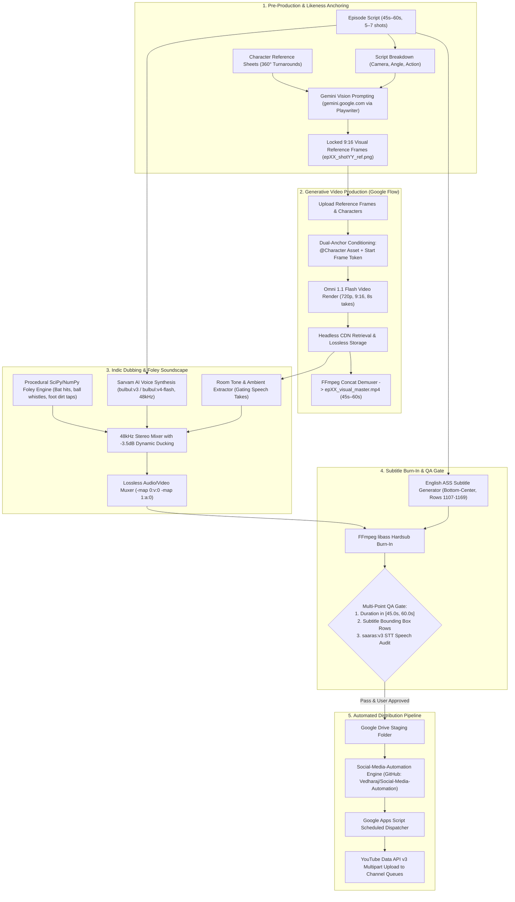
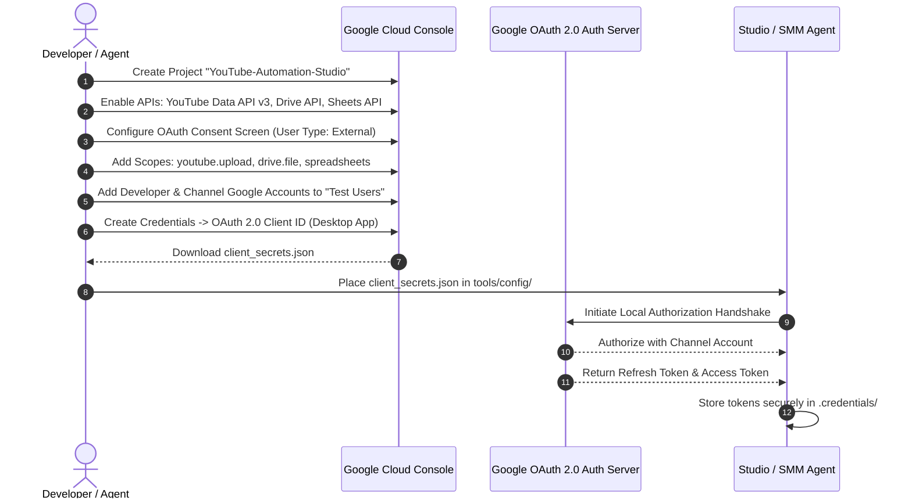
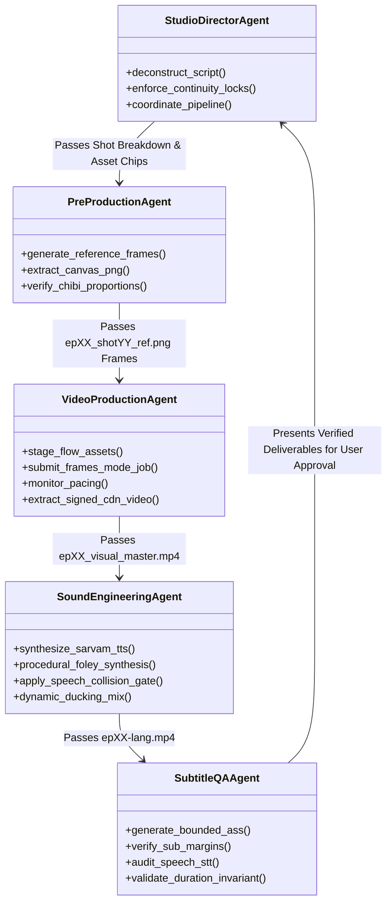

# Autonomous Vertical Short Fiction Studio: Master Production Guide & Reproduction Kit

> **System Standard:** 9:16 Vertical Video (720×1280, 24fps) | **Episode Runtime:** Strictly 45.0s to 60.0s  
> **Visual Engine:** Google Flow (`flow.google.com`) with Dual-Anchor Conditioning  
> **Pre-Production:** Google Gemini (`gemini.google.com`) via Playwriter MCP  
> **Sound & Dubbing Engine:** Sarvam AI (`bulbul:v3` / `bulbul:v4-flash`), Procedural SciPy Foley & 48kHz Dynamic Ducking  
> **Downstream Publishing Tool:** [Social-Media-Automation](https://github.com/Vedharaj/Social-Media-Automation)  

---

## Table of Contents
1. [System Mission & Architecture Overview](#1-system-mission--architecture-overview)
2. [Prerequisites & Zero-to-One Environment Setup](#2-prerequisites--zero-to-one-environment-setup)
3. [Cloud Infrastructure & API Setup Guide](#3-cloud-infrastructure--api-setup-guide)
   - [3.1 Google Cloud Console Setup (`console.cloud.google.com`)](#31-google-cloud-console-setup)
   - [3.2 YouTube Brand Channel Setup & Verification](#32-youtube-brand-channel-setup--verification)
   - [3.3 Google Apps Script & Sheets Queue Setup (`scripts.google.com`)](#33-google-apps-script--sheets-queue-setup)
   - [3.4 Integration with Social-Media-Automation Engine](#34-integration-with-social-media-automation-engine)
4. [Autonomous Multi-Agent Architecture](#4-autonomous-multi-agent-architecture)
5. [Skills & Customizations Specification](#5-skills--customizations-specification)
6. [MCP Servers Configuration](#6-mcp-servers-configuration)
7. [The Operational Invariants & Rules Bible](#7-the-operational-invariants--rules-bible)
8. [Battle-Tested Pitfall Avoidance & Runbook (The "Don't Repeat These Mistakes" Guide)](#8-battle-tested-pitfall-avoidance--runbook)
9. [End-to-End Production Walkthrough (Zero to Published Master)](#9-end-to-end-production-walkthrough)
10. [Verification Checklists & Acceptance Gate](#10-verification-checklists--acceptance-gate)

---

## 1. System Mission & Architecture Overview

The **Autonomous Vertical Short Fiction Studio** is a fully automated, agent-directed production pipeline designed to produce serialized 9:16 vertical fiction shorts (YouTube Shorts & Instagram Reels) at broadcast quality. 

The studio eliminates traditional production bottlenecks (actor availability, physical sets, multi-camera rigs, dubbing studios) while resolving the classical failure modes of generative AI video:
- **Character Likeness Drift:** Solved via Dual-Anchor Conditioning (360° turnaround body profile registration + start-frame conditioning).
- **Lip-Sync Desync & Distortion:** Solved via Acoustic-Visual Decoupling (off-screen dialogue, reaction cutaways, over-the-shoulder framing, and strict $\ge 0.4\text{s}$ audio-visual boundary guards).
- **AI Voice Hallucination & Collision:** Solved via Speech Collision Gating (purging raw AI audio on dialogue takes, dynamically ducking background room beds by $-3.5\text{dB}$, and synthesizing custom multi-character Indic voice tracks via Sarvam AI).
- **Subtitle Obstruction:** Solved via mathematically bounded ASS subtitles positioned at bottom-center (rows 1107–1169), ensuring zero occlusion of faces, torsos, or native mobile platform UI overlays.

### System Architecture Diagram



---

## 2. Prerequisites & Zero-to-One Environment Setup

The pipeline is completely cross-platform and can be run on Ubuntu/Debian Linux, macOS, or Windows (via WSL2).

### 2.1 System Packages
Install FFmpeg with `libass` and `libx264` support, Node.js 18+, Python 3.10+, and Google Chrome:

```bash
# Ubuntu / Debian
sudo apt update && sudo apt install -y \
  ffmpeg \
  libass-dev \
  python3 \
  python3-pip \
  python3-venv \
  nodejs \
  npm \
  curl \
  jq

# Verify FFmpeg supports libass hardsubbing
ffmpeg -version | grep --color=auto "enable-libass"
```

### 2.2 Python Environment & Dependencies
Create a dedicated virtual environment and install core scientific, audio processing, and networking libraries:

```bash
python3 -m venv ~/yt-studio-env
source ~/yt-studio-env/bin/activate

pip install --upgrade pip
pip install \
  numpy \
  scipy \
  requests \
  pillow \
  google-api-python-client \
  google-auth-oauthlib \
  google-auth-httplib2
```

### 2.3 Directory Structure Invariant
Every series project follows this standardized filesystem tree:

```
yt-series/
├── series_name/
│   ├── GEMINI.md                            # Series-specific production rules & invariants
│   ├── series_package.md                    # Series bible, world rules, character bios
│   ├── episodes_detailed.md                 # Full episode script breakdown (all episodes)
│   ├── assets/
│   │   ├── references/                      # 360° turnaround body sheets & environment plates
│   │   │   ├── character_a.png
│   │   │   ├── character_a_body_360.png
│   │   │   └── environment_ground.png
│   │   ├── ep01/                            # Episode 1 visual assets, refs, and masters
│   │   │   ├── ep01_shot01_ref.png
│   │   │   ├── ep01_shot01.mp4
│   │   │   ├── ep01_visual_master.mp4
│   │   │   ├── ep01-tamil-captioned.mp4
│   │   │   └── ep01-hindi-captioned.mp4
│   │   └── ep02/
│   └── scripts/                             # Dubbing, muxing, and STT verification scripts
│       ├── dub_series_ep01.py
│       └── dub_series_ep02.py
└── tools/                                   # Shared studio utilities
    ├── flow_service.sh                      # Chrome CDP & Flow daemon launcher
    ├── sarvam_dub.py                        # Standalone Sarvam voice synthesizer
    └── smm_queue_episode.py                 # Distribution queue staging bridge
```

---

## 3. Cloud Infrastructure & API Setup Guide

To automate cloud distribution, queueing, and multi-channel uploads, set up the Google Cloud Platform (GCP) ecosystem, Google Apps Script, and YouTube Brand Channels.

### 3.1 Google Cloud Console Setup (`console.cloud.google.com`)



#### Step-by-Step Instructions:
1. **Create a Cloud Project:**
   - Navigate to [Google Cloud Console](https://console.cloud.google.com/).
   - Click the Project dropdown at the top left $\to$ **New Project**.
   - Name: `Shorts-Automation-Studio`. Click **Create**.
2. **Enable Required APIs:**
   - Go to **APIs & Services $\to$ Library**.
   - Search for and enable the following 3 APIs:
     1. **YouTube Data API v3** (for uploading videos, setting playlists, managing titles/tags).
     2. **Google Drive API** (for downloading raw takes and hosting master staged videos).
     3. **Google Sheets API** (for reading schedule rows and logging run states).
3. **Configure OAuth Consent Screen:**
   - Go to **APIs & Services $\to$ OAuth consent screen**.
   - Select **External** (unless you have a Google Workspace organization) and click **Create**.
   - App Name: `Studio Video Publisher`.
   - User Support Email: your primary Google account.
   - Developer Contact Email: your primary Google account.
   - In **Scopes**, click **Add or Remove Scopes** and select:
     - `https://www.googleapis.com/auth/youtube.upload`
     - `https://www.googleapis.com/auth/youtube`
     - `https://www.googleapis.com/auth/drive.file`
     - `https://www.googleapis.com/auth/spreadsheets`
   - In **Test Users**, add every Google account that owns or manages your YouTube Brand Channels. (Crucial: Unverified external apps can only authenticate accounts added as Test Users).
4. **Create OAuth Client ID:**
   - Go to **APIs & Services $\to$ Credentials**.
   - Click **+ Create Credentials $\to$ OAuth client ID**.
   - Application Type: **Desktop app** (or **Web Application** if running a hosted service with redirect URI `http://localhost:8080/oauth2callback`).
   - Name: `Studio-CLI-Client`. Click **Create**.
   - Click **Download JSON** and save as `client_secrets.json`.

---

### 3.2 YouTube Brand Channel Setup & Verification

For multi-language distribution (e.g. Tamil, Hindi, Telugu, English), manage individual **Brand Accounts** under a single primary Google Account.

1. **Create Brand Channels:**
   - Sign in to YouTube with your primary account.
   - Go to [YouTube Account Switcher](https://www.youtube.com/channel_switcher).
   - Click **Create a Channel**.
   - Channel Name: `Story Time Tamil` (or `Story Time Hindi`).
   - Complete channel creation. Repeat for additional languages.
2. **Mandatory Channel Verification (Phone Verification):**
   - In YouTube Studio (`studio.youtube.com`), navigate to **Settings $\to$ Channel $\to$ Feature Eligibility**.
   - Enable **Intermediate Features** (requires SMS phone verification).  
     *Why this is mandatory:* Without this, YouTube blocks uploads longer than 15 minutes, custom thumbnails, and limits daily Shorts uploads to 10 per day.
   - Enable **Advanced Features** (via Video verification, Valid ID, or Channel history) to unlock maximum daily upload quotas.
3. **Authorize Channel Tokens:**
   - When running OAuth authentication, the browser will prompt you to choose **which channel** you are authorizing. Always select the specific Brand Account matching the language track.

---

### 3.3 Google Apps Script & Sheets Queue Setup (`scripts.google.com`)

The distribution pipeline uses a central Google Spreadsheet as the single source of truth for scheduling and status tracking.

1. **Create the Spreadsheet:**
   - Create a Google Sheet named `YouTube_Publishing_Queue`.
   - Create two tabs:
     * **Channels Tab:** Columns: `channel_name`, `channel_id`, `language_code`, `schedule_hours_utc`, `status`
     * **Videos Tab:** Columns: `id`, `series_name`, `episode_num`, `language`, `title`, `description`, `tags`, `drive_video_link`, `status`, `youtube_video_id`, `published_at`
2. **Create the Apps Script Project:**
   - In the Google Sheet, click **Extensions $\to$ Apps Script**.
   - Link the Apps Script project to your GCP Project:
     - In Apps Script Settings $\to$ **Google Cloud Platform (GCP) Project**, click **Change project**.
     - Enter your GCP Project Number (found on the GCP Console Dashboard).
3. **Set Up Execution Triggers:**
   - In Apps Script, click **Triggers (clock icon) $\to$ Add Trigger**.
   - Function: `processScheduledChannels`.
   - Event Source: **Time-driven $\to$ Hour timer $\to$ Every hour**.

---

### 3.4 Integration with Social-Media-Automation Engine

For end-to-end automated publishing, the studio relies on the open-source automation engine:
👉 **Repository:** [https://github.com/Vedharaj/Social-Media-Automation](https://github.com/Vedharaj/Social-Media-Automation)

> [!NOTE]
> This guide does not document the internal codebase or architecture of `Social-Media-Automation`. Refer to its repository for internal details. The studio connects to it strictly as a downstream consumer via the CLI bridge:
> ```bash
> # Add verified master to the distribution queue
> python3 /media/vedha/E2/freelance/tools/smm_queue_episode.py \
>   --video "/path/to/ep01-tamil-captioned.mp4" \
>   --mode queue \
>   --channel "Story Time Tamil" \
>   --lang "ta-IN" \
>   --episode 1 \
>   --title "The Usual Loss 🏏 | Match Fixers Ep. 1 #Shorts #Tamil"
> ```

---

## 4. Autonomous Multi-Agent Architecture

The studio operates as a cooperative ensemble of specialized autonomous subagents. Each agent has a distinct operational scope, tool allowance, and validation boundary.



### 4.1 Subagent Roles & Prompts

| Subagent Name | Role Title | Core Capabilities | Output Deliverable |
| :--- | :--- | :--- | :--- |
| `director-agent` | Executive Producer | Script breakdown, shot pacing, continuity invariants | `shot_plan.json` (5–7 shots, 45s–60s) |
| `preprod-gemini` | Pre-Production Director | Gemini Vision image generation with image conditioning | `epXX_shotYY_ref.png` (9:16 vertical, no text) |
| `flow-video-agent` | Generative Video Producer | Google Flow automation, Start-frame conditioning | `scene-01.mp4` to `scene-0X.mp4`, `visual_master.mp4` |
| `sound-engineer` | Audio Engineer & Foley Artist | Sarvam AI TTS, SciPy Foley, -3.5dB ducking | `soundtrack_ta.wav`, `soundtrack_hi.wav` (48kHz stereo) |
| `sub-qa-agent` | Subtitle & Compliance Auditor | ASS styling, bounding box pixel audits, STT check | `epXX-lang-captioned.mp4`, QA report |

---

## 5. Skills & Customizations Specification

Skills encapsulate procedural workflows into version-controlled markdown guides that agents consult dynamically.

### Key Skills Directory:
- `google-flow-production`: Flow project setup, character asset registration, Start-frame video conditioning, and signed CDN URL harvesting.
- `sarvam-indic-dubbing`: Multi-speaker voice synthesis, acoustic room impulse modeling, and procedural SciPy foley generation.
- `playwriter`: Headless browser automation patterns for high-interaction Google SPAs.

#### Skill Folder Architecture:
```
skills/google-flow-production/
├── SKILL.md                 # Primary instruction guide with YAML frontmatter
├── scripts/
│   ├── check_flow_status.sh # Health-check for CDP and MCP ports
│   └── extract_video_url.js # DOM helper for signed video tag extraction
└── examples/
    └── prompt_templates.md  # Approved sanitization prompt patterns
```

---

## 6. MCP Servers Configuration

The studio utilizes Model Context Protocol (MCP) servers to allow agents to interact with browsers and local services.

### 6.1 `playwriter` MCP Server Configuration
Connects directly to the user's running Chrome instance via Chrome DevTools Protocol (CDP), avoiding bot detection and preserving authenticated Google sessions:

```json
{
  "mcpServers": {
    "playwriter": {
      "command": "npx",
      "args": ["-y", "playwriter@latest"],
      "env": {
        "PLAYWRITER_PORT": "9333"
      }
    },
    "google-workspace": {
      "command": "npx",
      "args": ["-y", "@google-workspace/mcp-server"],
      "env": {
        "GOOGLE_APPLICATION_CREDENTIALS": "/home/vedha/.credentials/workspace_oauth.json"
      }
    }
  }
}
```

---

## 7. The Operational Invariants & Rules Bible

These non-negotiable rules govern every autonomous run. Any deviation triggers an immediate halt and self-correction.

### Rule 1: Duration Standard Invariant (45.0s to 60.0s)
Every episode must have a total runtime strictly between 45.0 and 60.0 seconds. 
- Target structure: 6 shots of ~8.0s each ($48.0\text{s}$) or 7 shots of 7s–8s ($50.0\text{s}$).
- Episodes $< 45.0\text{s}$ fail YouTube Shorts long-format monetization and engagement metrics.
- Episodes $> 60.0\text{s}$ are rejected by YouTube Shorts algorithms and categorized as standard horizontal videos.

### Rule 2: Dual-Anchor Conditioning & Character Likeness
Never generate character video shots purely from text prompts. Every generation must attach BOTH:
1. The registered character asset chip (`@CharacterName` or `asset:CharacterName`).
2. The specific shot reference image chip (`epXX_shotYY_ref.png`) loaded as the **Start Frame (Frame 0)** in Flow's Frames mode.

### Rule 3: Visual Prompt Dialogue Sanitization
**NEVER put spoken dialogue inside video generation prompts.**
- *Bad:* `Chintu swings bat, screaming "I closed my eyes!" in fear.`
- *Good:* `Chibi rookie batsman flinches comically with both eyes squeezed shut, swinging wooden bat blindly. Clean vector-illustration chibi animation matching start frame.`
- *Why:* Generative video models (like Omni 1.1 Flash) will attempt to synthesize English sports commentary or gibberish speech audio if dialogue is present in the prompt, corrupting the audio bed.

### Rule 4: Acoustic-Visual Decoupling (Zero Lip-Sync Desync)
Generative AI video models cannot maintain realistic lip-sync for fast Indian language dialogue. Decouple dialogue visually:
- Frame talking characters from **3/4 profile**, **over-the-shoulder**, or **wide cricket ground angles**.
- Cut to **listener reactions**, **flying balls**, **scoreboards**, or **pitch dust swirls** during speech lines.
- Front-facing speaking shots are allowed only for ultra-short 1–2 word interjections ($< 1.5\text{s}$), such as *"Six-ah?!"* or *"Out-ah?!"*.
- Maintain $\ge 0.4\text{s}$ audio-visual cushion before and after cut transitions.

### Rule 5: Speech Collision Gating & Dynamic Ducking
1. **Purge Raw AI Vocals:** Audit raw video takes. In any shot where dialogue occurs, discard raw audio entirely.
2. **Preserve Authentic Room Tone:** Extract room ambiance (cricket ground wind, cicadas, crowd hum) from speech-free takes and blend it into the master bed.
3. **Dynamic Ducking:** Duck the ambient/foley track by $-3.5\text{dB}$ to $-4.0\text{dB}$ whenever dialogue lines are active to ensure vocal clarity.

### Rule 6: Bottom-Center Subtitle Protection (Rows 1107–1169)
Subtitles must never occlude character faces, bodies, or mobile platform UI buttons (like, comment, share icons).
- Format: English Advanced SubStation Alpha (`.ass`).
- Canvas Resolution: `PlayResX: 720`, `PlayResY: 1280`.
- Style: `Fontname: Arial`, `Fontsize: 34`, `Bold: 1`, `Alignment: 2` (Bottom-Center), `MarginV: 110`.
- Vertical bounds: Text pixels must be strictly bounded between vertical lines **1050 and 1180** (~111px clearance above bottom screen edge).

### Rule 7: Mandatory User Approval Gate
**Never upload video files to Google Drive, never execute `smm queue add`, and never modify production Google Sheets rows without explicit user sign-off.**
Always present the locally assembled master, QA audit metrics, and keyframe stills to the user first.

---

## 8. Battle-Tested Pitfall Avoidance & Runbook

This section codifies solutions to real-world edge cases encountered across production runs.

```
┌─────────────────────────────────────────────────────────────────────────────────────────┐
│                                 BATTLE-TESTED RUNBOOK                                   │
├──────────────────────────┬─────────────────────────────────┬────────────────────────────┤
│ Trap / Failure Mode      │ Root Cause                      │ Definitive Solution        │
├──────────────────────────┼─────────────────────────────────┼────────────────────────────┤
│ 1. Text Input Timeout    │ page.keyboard.type() enters     │ Use document.execCommand(  │
│    (10000ms Playwriter)  │ character by character (~10s)   │ 'insertText', false, text) │
├──────────────────────────┼─────────────────────────────────┼────────────────────────────┤
│ 2. Hidden Flow Input     │ Flow DOM has hidden textarea    │ Target contenteditable div │
│    Collision             │ for recaptcha-response (len>2k) │ .ProseMirror[role="textbox │
├──────────────────────────┼─────────────────────────────────┼────────────────────────────┤
│ 3. SPA Navigation Hang   │ waitUntil: 'networkidle' hangs  │ Use standard page.goto()   │
│                          │ on continuous Flow web sockets  │ with explicit selector wait│
├──────────────────────────┼─────────────────────────────────┼────────────────────────────┤
│ 4. Angular Click Failure │ Angular Material buttons ignore │ Dispatch full pointer chain│
│                          │ synthetic btn.click() events    │ (pointerdown->mousedown->  │
│                          │                                 │ mouseup->click)            │
├──────────────────────────┼─────────────────────────────────┼────────────────────────────┤
│ 5. Gemini Blob Fetch Err │ window.fetch() fails on blob:   │ Render image to HTML5      │
│                          │ URLs across security contexts   │ Canvas and extract Base64  │
│                          │                                 │ via canvas.toDataURL()     │
├──────────────────────────┼─────────────────────────────────┼────────────────────────────┤
│ 6. Flow Video Modal Hang │ Flow video player modal has     │ Hover over tile to get     │
│                          │ unstable traversal selectors    │ video.src CDN URL or click │
│                          │                                 │ Download in take edit page │
├──────────────────────────┼─────────────────────────────────┼────────────────────────────┤
│ 7. Timeline Add-Clip     │ Add-clip button only attaches   │ Click last clip in timeline│
│    Disappearance         │ to the SELECTED timeline clip   │ first, then trigger its    │
│                          │                                 │ .add-clip-button overlay   │
└──────────────────────────┴─────────────────────────────────┴────────────────────────────┘
```

### Detailed Implementation Snippets:

#### 1. Instant Text Input in Rich-Text Editors:
```javascript
// Avoids 10-second timeouts on lengthy prompts
await page.evaluate((text) => {
  const el = document.querySelector('.ProseMirror') || document.querySelector('[contenteditable="true"]');
  el.focus();
  document.execCommand('selectAll', false, null);
  document.execCommand('delete', false, null);
  document.execCommand('insertText', false, text);
}, promptText);
```

#### 2. HTML5 Canvas Blob Image Extraction in Gemini:
```javascript
const base64Data = await page.evaluate(async () => {
  const imgs = Array.from(document.querySelectorAll('model-response img'));
  const lastImg = imgs[imgs.length - 1];
  if (!lastImg) return null;
  
  const canvas = document.createElement('canvas');
  canvas.width = lastImg.naturalWidth;
  canvas.height = lastImg.naturalHeight;
  const ctx = canvas.getContext('2d');
  ctx.drawImage(lastImg, 0, 0);
  return canvas.toDataURL('image/png').replace(/^data:image\/png;base64,/, '');
});
```

#### 3. Angular Material Synthetic Event Dispatcher:
```javascript
await page.evaluate((selector) => {
  const btn = document.querySelector(selector);
  if (!btn) return false;
  ['pointerdown', 'mousedown', 'mouseup', 'click'].forEach(evt => {
    btn.dispatchEvent(new MouseEvent(evt, { bubbles: true, cancelable: true }));
  });
  return true;
}, '.add-clip-button');
```

---

## 9. End-to-End Production Walkthrough

### Step 1: Script & Shot Breakdown
Take the episode script and split into 6 shots of exactly 8.0s (total $48.0\text{s}$):
- `Shot 1 (0:00–0:08)`: Context / Hero Stance (Chintu nervous at batting crease).
- `Shot 2 (0:08–0:16)`: Captain dialogue cutaway (Veera shouting from mid-off).
- `Shot 3 (0:16–0:24)`: Comedic action beat (Chintu blind panic swing, eyes squeezed shut).
- `Shot 4 (0:24–0:32)`: Miracle payoff wide shot (Ball soaring clean over boundary tree).
- `Shot 5 (0:32–0:40)`: Bewildered reaction (Chintu blinking confused, team jaws dropped).
- `Shot 6 (0:40–0:48)`: Celebratory resolution (Pandi hoisting Chintu's arm like a referee).

### Step 2: Reference Image Generation in Gemini
1. Open Gemini (`gemini.google.com`) tab.
2. Attach character reference PNG (`assets/references/chintu.png`).
3. Submit 9:16 vertical vector art prompt.
4. Extract rendered image via HTML5 Canvas $\to$ save to `assets/epXX/epXX_shotYY_ref.png`.

### Step 3: Google Flow Video Take Generation
1. In Flow (`flow.google.com`), select **Frames mode** (720p, 8s, 9:16 vertical, Omni 1.1 Flash).
2. Upload `epXX_shotYY_ref.png` and set as **Start Frame**.
3. Input sanitized behavioral prompt (expressions and camera motion only).
4. Render take $\to$ download to `assets/epXX/epXX_shotYY.mp4`.

### Step 4: Lossless Video Concat Assembly
Assemble the visual master using the FFmpeg concat demuxer:
```bash
cat << 'EOF' > /tmp/ep04_concat.txt
file '/media/vedha/E2/freelance/yt-series/match_fixer/assets/ep04/ep04_shot01.mp4'
file '/media/vedha/E2/freelance/yt-series/match_fixer/assets/ep04/ep04_shot02.mp4'
file '/media/vedha/E2/freelance/yt-series/match_fixer/assets/ep04/ep04_shot03.mp4'
file '/media/vedha/E2/freelance/yt-series/match_fixer/assets/ep04/ep04_shot04.mp4'
file '/media/vedha/E2/freelance/yt-series/match_fixer/assets/ep04/ep04_shot05.mp4'
file '/media/vedha/E2/freelance/yt-series/match_fixer/assets/ep04/ep04_shot06.mp4'
EOF

ffmpeg -y -f concat -safe 0 -i /tmp/ep04_concat.txt -c copy \
  /media/vedha/E2/freelance/yt-series/match_fixer/assets/ep04/ep04_visual_master.mp4
```

### Step 5: Multi-Language Audio Synthesis & Mixing
Execute the automated dubbing script:
```bash
python3 /media/vedha/E2/freelance/yt-series/match_fixer/scripts/dub_match_fixer_ep04.py
```
This script automatically:
1. Synthesizes dialogue via Sarvam AI API for Tamil (`ratan`, `ishita`) and Hindi (`shubh`, `priya`).
2. Synthesizes synchronized 48kHz SciPy foley beds (bat taps, dirt footsteps, wood cracks).
3. Gates and purges raw speech take audio, mixing background tone with dynamic $-3.5\text{dB}$ ducking.
4. Generates compliant English ASS subtitles and burns them into final video files.
5. Runs automated STT speech-collision audits using Sarvam `saaras:v3`.
6. Extracts frame verification stills for visual inspection.

---

## 10. Verification Checklists & Acceptance Gate

Before submitting any episode to the publishing queue, execute this automated verification audit:

```python
import subprocess, numpy as np
from PIL import Image

def verify_episode_master(video_path, ass_path):
    print(f"Auditing master: {video_path}")
    
    # 1. Verify Duration & Dimensions
    probe = subprocess.check_output([
        'ffprobe', '-v', 'error',
        '-select_streams', 'v:0',
        '-show_entries', 'stream=width,height,duration',
        '-of', 'csv=p=0',
        video_path
    ]).decode().strip().split(',')
    
    w, h, dur = int(probe[0]), int(probe[1]), float(probe[2])
    assert w == 720 and h == 1280, f"Invalid resolution: {w}x{h} (Must be 720x1280)"
    assert 45.0 <= dur <= 60.0, f"Duration violation: {dur:.2f}s (Must be between 45.0s and 60.0s)"
    print(f"✅ Dimensions & Duration: {w}x{h}, {dur:.2f}s [PASS]")

    # 2. Audit Subtitle Bounding Box on Blank Canvas
    test_sub_png = '/tmp/sub_audit.png'
    subprocess.run([
        'ffmpeg', '-y', '-f', 'lavfi',
        '-i', 'color=c=black:s=720x1280:d=60',
        '-ss', '00:00:10',
        '-vf', f"ass='{ass_path}'",
        '-vframes', '1',
        test_sub_png
    ], check=True, stdout=subprocess.DEVNULL, stderr=subprocess.DEVNULL)
    
    arr = np.array(Image.open(test_sub_png).convert('L'))
    y, _ = np.where(arr > 30)
    if len(y) > 0:
        assert y.min() >= 1050, f"Subtitle violates chest/face protection: row {y.min()} is too high!"
        assert y.max() <= 1180, f"Subtitle extends too low into mobile UI zone: row {y.max()}!"
        print(f"✅ Subtitle Safe Zone: rows {y.min()} to {y.max()} [PASS]")
    
    print("🎉 Master passed all quality checks!")

verify_episode_master(
    '/media/vedha/E2/freelance/yt-series/match_fixer/assets/ep04/ep04-tamil-captioned.mp4',
    '/media/vedha/E2/freelance/yt-series/match_fixer/assets/ep04/ep04-en.ass'
)
```

---
*Autonomous Vertical Short Fiction Studio • Standardized Production Runbook*
