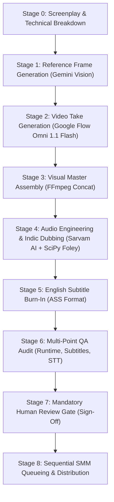

# Autonomous Vertical Video Studio

> An end-to-end, multi-agent autonomous production system for generating, dubbing, mastering, and scheduling 9:16 vertical short fiction series (YouTube Shorts & Instagram Reels, 45.0s–60.0s per episode).

---

## System Mission & Architectural Highlights

The **Autonomous Vertical Video Studio** is an agentic production pipeline designed to eliminate traditional media bottlenecks while resolving the primary failure modes of generative AI video:

1. **Character Likeness Drift:** Solved via **Dual-Anchor Conditioning** (registered 360° turnaround body profile chips + shot reference image chips).
2. **Diffusion Multi-Panel Artifacts:** Solved via **Single-Perspective Reference Guards** enforcing unified camera angles with strict negative constraints.
3. **AI Voice Collision & Double Voices:** Solved via **Speech Collision Gating** (completely muting raw take audio during dialogue windows and dynamically ducking background beds by -3.5dB).
4. **Lip-Sync Desync:** Solved via **Acoustic-Visual Decoupling** (off-screen dialogue, reaction cutaways, over-the-shoulder framing, and strict $\le 2.0\text{s}$ limits on direct front-facing dialogue).
5. **Subtitle Obstruction:** Solved via mathematically bounded **Bottom-Center English ASS Subtitles** (vertical rows 1107–1169, ~111px above bottom edge).
6. **Serial Publishing Inversion:** Solved via the **Sequential Publishing Order Invariant** (verifying predecessor episodes $1 \dots N-1$ before queueing Episode $N$).

---

## Production Lifecycle Overview



---

## Repository Structure

```text
.
├── README.md                          # Studio overview and quickstart
├── AGENTS.md                          # Studio discovery file and 10 Commandments
├── GEMINI.md                          # Operational invariants and production bible
├── AUTONOMOUS_VERTICAL_STUDIO_MASTER_GUIDE.md # 600+ line master production guide
├── WORKFLOW_PROCESS_GUIDE.md          # 8-stage step-by-step workflow runbook
├── docs/                              # System documentation
│   ├── WORKFLOW.md                    # Detailed stage breakdown and commands
│   ├── ARCHITECTURE.md                # Multi-agent topology and protocols
│   ├── AGENT_INVENTORY.md             # Inventory of agents, skills, and tools
│   ├── SETUP.md                       # Zero-to-one installation guide
│   ├── TROUBLESHOOTING.md             # Failure modes and battle-tested fixes
│   ├── PORTABILITY.md                 # Migration and decoupling runbook
│   └── DECISIONS.md                   # Architecture Decision Records (ADRs)
├── agents/                            # Specialized agent role specifications
│   ├── workflow-orchestrator.md       # Production coordinator & gatekeeper
│   ├── visual-director.md             # Gemini prompter & Flow director
│   ├── audio-engineer.md              # Voice director & Foley sound designer
│   └── qa-publisher.md                # Compliance auditor & SMM dispatcher
├── .agents/                           # AGI CLI project-local discovery root
│   ├── rules/                         # Workspace rules and invariants
│   └── skills/                        # Localized production skills
│       ├── google-flow-production/    # Flow CDP automation & verified retrieval
│       ├── sarvam-indic-dubbing/      # Sarvam TTS/STT & procedural Foley
│       └── short-form-series-production/ # Master lifecycle and queue gates
├── prompts/                           # Production prompt bibles
│   ├── gemini_reference_prompts.md    # Single-perspective reference prompts
│   ├── flow_video_prompts.md          # Sanitized video generation prompts
│   └── indic_dubbing_prompts.md       # Dubbing bibles and ASS subtitle styles
├── config/                            # Configuration templates
│   ├── .env.example                   # API keys and environment variables
│   ├── config.example.yaml            # YAML configuration schema
│   └── config.example.json            # JSON configuration schema
├── scripts/core/                      # Reusable studio automation tools
│   ├── flow_service.sh                # Chrome CDP & Flow MCP service manager
│   ├── sarvam_dub_engine.py           # Parameterized dubbing & Foley engine
│   └── smm_publisher.py               # Sequential SMM queue dispatcher
├── templates/                         # New series generators
│   ├── bootstrap_new_series.sh        # Self-contained series initializer
│   └── video-series-template/         # Portable new series skeleton
└── tests/                             # Automated test and audit suite
    ├── test_environment.py            # System prerequisites & API audit
    ├── test_subtitle_bounds.py        # ASS subtitle vertical safe-zone tester
    └── test_audio_alignment.py        # Media duration and alignment tester
```

---

## Quick Start

### 1. Prerequisites
* Python 3.10+ (`requests`, `numpy`, `scipy`, `pyyaml`)
* FFmpeg with `libass` and `libx264` support
* Google Chrome (for Playwriter MCP and Flow CDP automation)
* SMM CLI (`Social-Media-Automation`)

### 2. Environment Setup
```bash
cp config/.env.example config/.env
# Edit config/.env with your credentials:
# export SARVAM_API_KEY="your_api_key_here"
source config/.env
```

### 3. Verify System Health
```bash
python3 tests/test_environment.py
```

### 4. Bootstrapping a New Series Project
To spin up a new self-contained series without global pollution:
```bash
bash templates/bootstrap_new_series.sh \
  --name "village-detective" \
  --target "/path/to/my-series/village-detective"
```

---

## Core Architectural Mandates (The 10 Commandments)

1. **Inspect before creating:** Check existing files and configs before implementing anything.
2. **Local by default:** All project-specific agents, skills, and configs belong inside the project.
3. **Global only by exception:** Use global resources only when intentionally shared or technically required.
4. **No silent migration:** Record proposed changes before applying them.
5. **No destructive cleanup:** Never delete existing resources until the replacement is verified.
6. **No invented APIs:** Follow supported AGI CLI discovery paths.
7. **Reproducible setup:** Ensure any machine can reconstruct the workflow using documented steps.
8. **Dependency transparency:** Document external and global dependencies explicitly.
9. **Test before declaring success:** Run automated audits before declaring any task complete.
10. **Update documentation:** Maintain synchronized docs for any architectural change.

---

## License

MIT License. Designed for autonomous AI production workflows.
