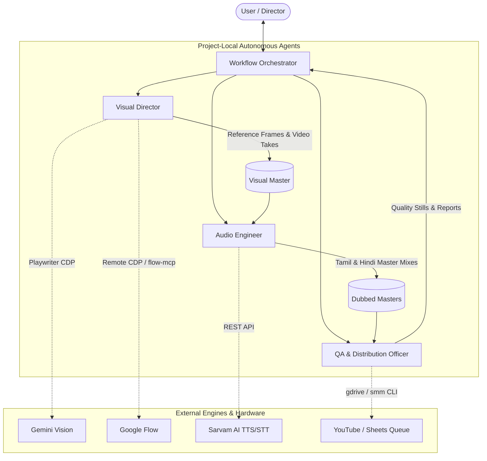

# Multi-Agent Architecture Specification

> Specialist agent topology, role definitions, and communication protocols for the autonomous vertical short fiction studio.

---

## Agent Topology Diagram

---

## Specialist Agent Specifications

### 1. Workflow Orchestrator (`agents/workflow-orchestrator.md`)
* **Role:** Production showrunner and lifecycle coordinator.
* **Responsibilities:**
  * Coordinates sequential execution through Stages 0 to 8.
  * Enforces project-local isolation: strictly prevents saving project assets or configs in global paths.
  * Maintains the Continuity Invariants Ledger (character props, storylines, scoreboards).
  * Enforces the Mandatory Human Approval Gate: compiles keyframe stills, audio checks, and metrics; halts execution until explicit user sign-off is received.
  * Enforces the Sequential Publishing Order Invariant during queueing.

### 2. Visual Director (`agents/visual-director.md`)
* **Role:** Camera operator, prompt engineer, and video asset manager.
* **Responsibilities:**
  * Authors deterministic Gemini Vision reference prompts with mandatory single-perspective constraints.
  * Interacts with Gemini via Playwriter MCP to generate 9:16 vertical reference images.
  * Conditions Google Flow video takes using Dual-Anchor tokens (`@Character` asset chip + shot reference image chip).
  * Executes prompt sanitization (behavioral cues only, zero spoken dialogue text).
  * Executes the Verified Take Retrieval Gate: confirms take title in the Flow UI header before downloading to prevent wrong-video corruption.
  * Assembles losslessly stitched visual masters via FFmpeg concat demuxer.

### 3. Audio Engineer (`agents/audio-engineer.md`)
* **Role:** Multilingual voice director, Foley sound designer, and re-recording mixer.
* **Responsibilities:**
  * Implements Speech Collision Gating: completely mutes raw AI take audio during dialogue windows to prevent AI speech hallucination.
  * Extracts authentic environmental ambiance from speech-free takes.
  * Synthesizes 48kHz procedural SciPy/NumPy Foley effects (crease bat taps, bowler strides, bat cracks, fanfare).
  * Synthesizes multi-character Indic dialogue tracks using Sarvam AI (`bulbul:v3`) with character-matched voice archetypes.
  * Enforces Universal Dialogue Coverage: ensures every character action, comedy, or celebration beat has voiced dialogue in all target languages.
  * Applies dynamic ducking (-3.5dB to -4dB under speech) and normalizes masters to -0.5dB peak.
  * Generates synchronized bottom-center English ASS subtitles (rows 1107–1169).

### 4. QA & Distribution Officer (`agents/qa-publisher.md`)
* **Role:** Quality auditor and channel distribution dispatcher.
* **Responsibilities:**
  * Audits master video duration against the strict [45.0s, 60.0s] standard.
  * Audits subtitle vertical bounding box to guarantee zero face/chest obstruction.
  * Executes Sarvam STT verification (`saaras:v3`) on audio samples (<30s).
  * Extracts per-shot keyframe stills for user review.
  * Validates preceding queue rows ($1 \dots N-1$) in `Story Time Tamil` and `Story Time Hindi` prior to queue enrollment.
  * Orchestrates Google Drive uploads and invokes `smm queue add` only after explicit user approval.

---

## Agent Communication & Execution Principles

1. **Reactive Wakeup / No Polling:** Agents utilize system-level notifications, background tasks, and event-driven signals rather than busy-wait polling loops.
2. **Context Budgeting & Progressive Disclosure:** Agents read detailed reference manuals in `docs/` and `prompts/` on-demand rather than polluting prompt context.
3. **Idempotence & Reversibility:** Every stage produces standalone artifacts with deterministic filenames (`epXX_shotYY_ref.png`, `epXX_shotYY.mp4`, `epXX_visual_master.mp4`). Any failed stage can be re-run without re-generating upstream artifacts.
4. **Zero-Desync Acoustic Decoupling:** Long dialogue is framed off-screen or over-the-shoulder, while on-screen speaking shots are restricted to ultra-short reactive utterances ($\le 2.0\text{s}$).
