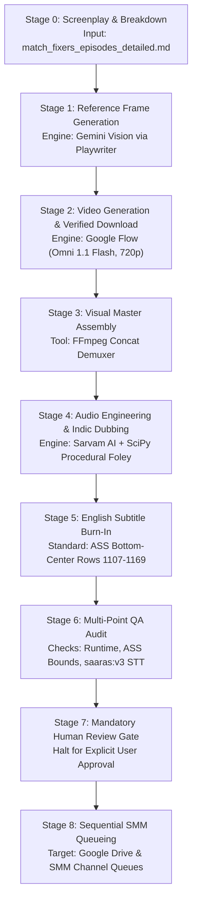

# Production Workflow Specification

> Comprehensive 8-stage production lifecycle for *Match Fixers* vertical short fiction episodes (9:16 vertical, 45.0s–60.0s).

---

## High-Level Execution Sequence



---

## Detailed Stage Breakdown

### Stage 0: Screenplay & Technical Shot Breakdown
* **Inputs:**
  * Series Bible: `match_fixers_series_package.md`
  * Episode Screenplay: `match_fixers_episodes_detailed.md`
* **Outputs:**
  * Exact shot list (5–8 shots, strictly 8.0s or 6.0s takes, summing to 45.0s–60.0s).
  * Framing architecture: Off-screen dialogue, cutaways, 3/4 profiles, and ultra-short direct face utterances ($\le 2.0\text{s}$).
  * Dialogue lines in Tamil (`ta-IN`) and Hindi (`hi-IN`).
* **Invariants Enforced:**
  * Total duration $\in [45.0\text{s}, 60.0\text{s}]$.
  * Universal Dialogue Coverage: No action, comedy, or celebration beat left silent.

---

### Stage 1: Visual Reference Frame Generation (Gemini Vision)
* **Inputs:**
  * Character reference turnaround sheets from `assets/references/` (`veera_body_360.png`, `chintu_body_360.png`, `pandi_body_360.png`, `boss_mani_body_360.png`).
  * Setting references (`village_ground.png`, `scorer_hut.png`, `boss_mani_shop.png`).
  * Shot description prompt.
* **Execution:**
  * Priority: Google Gemini (`gemini.google.com`) via Playwriter MCP.
  * Failover: ChatGPT/DALL-E 3 only if Gemini rate limits.
  * Composition Constraint: Single unified camera perspective.
  * Mandatory Negative Constraints:
    `"Single unified composition, absolutely NO split screen, NO multi-panel collage, NO duplicated characters, NO motion trail lines, NO text."`
* **Outputs:**
  * `assets/epXX/epXX_shotYY_ref.png` (9:16 vertical PNG, 720×1280).

---

### Stage 2: Generative Video Production (Google Flow)
* **Inputs:**
  * Flow Project: `04650c1f-af00-421c-b612-c35441066ff5` (`Match Fixers`).
  * Registered Character Asset Chips: `@Veera`, `@Chintu`, `@Pandi`, `@Kavya`, `@BossMani`.
  * Shot reference image chip: `epXX_shotYY_ref.png`.
* **Execution:**
  * Preset: `Omni 1.1 Flash`, `720p`, aspect ratio `9:16` vertical.
  * Dual-Anchor Conditioning: Attach both character chip and shot reference image chip.
  * Prompt Sanitization: Describe physical movements, expressions, and comedic reactions only. Never paste dialogue text into Flow prompts.
  * Duration per take: 8.0s (or 6.0s depending on script breakdown).
* **Verified Take Retrieval Gate:**
  * Once rendering reaches 100%, open the take in the Flow editor.
  * **Gate:** Check header (`h1` or `.header-title`) to confirm the title matches the target shot.
  * Never blindly click the first tile or download menu item.
  * Download the clean 720p video take via `Download media` -> `720p Original size`.
* **Outputs:**
  * `assets/epXX/epXX_shotYY.mp4` (720×1280, 24fps, H.264).

---

### Stage 3: Visual Master Assembly
* **Inputs:**
  * All downloaded scene takes: `epXX_shot01.mp4` through `epXX_shotNN.mp4`.
* **Execution:**
  * Generate demuxer list:
    ```bash
    cat << 'EOF' > assets/epXX/concat_list.txt
    file 'epXX_shot01.mp4'
    file 'epXX_shot02.mp4'
    ...
    EOF
    ```
  * Concatenate losslessly:
    ```bash
    ffmpeg -y -f concat -safe 0 -i assets/epXX/concat_list.txt \
      -c copy assets/epXX/epXX_visual_master.mp4
    ```
* **Outputs:**
  * `assets/epXX/epXX_visual_master.mp4` (Duration: strictly 45.0s–60.0s).

---

### Stage 4: Audio Engineering & Indic Dubbing (Sarvam AI & SciPy)
* **Script:** `scripts/dub_match_fixer_epXX.py`
* **Execution Sub-Phases:**
  1. **Acoustic Bed Assembly & Speech Collision Gating:**
     * Discard/mute raw take audio on all shots where character dialogue occurs to prevent AI voice hallucination.
     * Extract authentic crowd murmurs, bat strikes, and nature tone from non-speech takes.
     * Blend with procedural SciPy field wind (bandpass 60–420Hz) and cicadas.
  2. **Procedural SciPy Foley Engine:**
     * Crease bat tapping (450Hz damped clicks with exponential decay).
     * Bowler run-up footsteps and ball whistling swoosh.
     * Sweet-spot bat crack (1.2kHz high-impact damped impulse).
     * Distant tree rustle, umpire whistle, and comedic celebratory fanfare.
  3. **Sarvam AI Voice Synthesis:**
     * Model: `bulbul:v3` (48kHz sample rate, `temperature: 0.65`, `pace: 1.05–1.15`).
     * Voice Archetypes:
       * Veera: `ratan` (Tamil) / `shubh` (Hindi)
       * Chintu: `rohan` (Tamil) / `ashutosh` (Hindi)
       * Pandi: `vijay` (Tamil) / `varun` (Hindi)
       * Kavya: `ishita` (Tamil) / `priya` (Hindi)
       * Boss Mani: `ratan` (Tamil, authoritative pitch) / `shubh` (Hindi)
  4. **Dynamic Ducking & Mastering:**
     * Apply smooth -3.5dB to -4dB ducking under dialogue windows.
     * Normalize master soundtrack to -0.5dB peak.
     * Lossless muxing: `-map 0:v:0 -map 1:a:0` -> `epXX-tamil.mp4`, `epXX-hindi.mp4`.
* **Outputs:**
  * `assets/epXX/epXX-tamil.mp4`
  * `assets/epXX/epXX-hindi.mp4`

---

### Stage 5: English Subtitle Burn-In (ASS Standard)
* **Inputs:**
  * Spoken dialogue lines with exact start/end timestamps from dubbing timeline.
* **ASS Calibration Parameters:**
  * Resolution: `PlayResX: 720`, `PlayResY: 1280`
  * Style: `Fontname: Arial`, `Fontsize: 34`, `Bold: 1`, `Alignment: 2` (Bottom-Center), `MarginV: 110`
  * Primary Colour: `&H00FFFFFF` (White), Outline: `&H00000000` (Black), Outline Width: `3.0`
  * Vertical Safe Zone: Rows 1107–1169 (~111px above bottom edge). Zero obstruction of faces, chests, or mobile UI elements.
* **Execution:**
  ```bash
  ffmpeg -y -i assets/epXX/epXX-tamil.mp4 -vf "ass=assets/epXX/epXX-en.ass" \
    -c:v libx264 -crf 18 -preset fast -c:a copy assets/epXX/epXX-tamil-captioned.mp4
  ```
* **Outputs:**
  * `assets/epXX/epXX-tamil-captioned.mp4`
  * `assets/epXX/epXX-hindi-captioned.mp4`

---

### Stage 6: Multi-Point QA Verification Gate
* **Automated Checks:**
  1. **Duration Audit:** `ffprobe` confirms duration $\in [45.00\text{s}, 60.00\text{s}]$.
  2. **Subtitle Bounding Audit:** Verify ASS coordinates remain strictly within vertical rows 1107–1169.
  3. **STT Dialogue Verification:** Extract a 25.0s audio slice and submit to Sarvam `saaras:v3` STT to verify speech clarity.
  4. **Keyframe Stills Extraction:** Extract 1 representative JPEG per shot (`verify_s1_...jpg` to `verify_sN_...jpg`).
* **Outputs:**
  * Visual proof stills for human review.

---

### Stage 7: Mandatory Human Review Gate
* **INVARIANT:** No video may be uploaded to Google Drive or enrolled into SMM queues without explicit user authorization.
* Present keyframe stills, audio check results, and metrics to the user.
* Halt execution until the user responds with explicit approval (e.g. *"approved"*, *"proceed to queue"*).

---

### Stage 8: Sequential SMM Queueing & Distribution
* **Sequential Publishing Order Invariant:**
  * YouTube publishing processes rows strictly top-to-bottom.
  * Check existing queue rows on `Story Time Tamil` and `Story Time Hindi`.
  * Confirm that all predecessor episodes ($1 \dots N-1$) are already present in the queue with status `COMPLETE` or `READY`.
* **Execution:**
  1. Upload master videos to Google Drive folder: `1IxzXjqaFbCx6Audvw1pSmILrGzN8aqVp`.
  2. Add Tamil master to `Story Time Tamil` queue:
     ```bash
     smm queue add --channel "Story Time Tamil" --link "<drive_url>" \
       --title "<Title> 🏏😂 | Match Fixers Ep. N #Shorts #Tamil" ...
     ```
  3. Add Hindi master to `Story Time Hindi` queue:
     ```bash
     smm queue add --channel "Story Time Hindi" --link "<drive_url>" \
       --title "<Title> 🏏😂 | Match Fixers Ep. N #Shorts #Hindi" ...
     ```
* **Verification:** Run `smm queue list "Story Time Tamil"` to confirm enrollment with status `READY`.
